# Diagrams with explanation (Mermaid – rendered automatically on GitHub)

## 1. System flowchart (Exp 1)
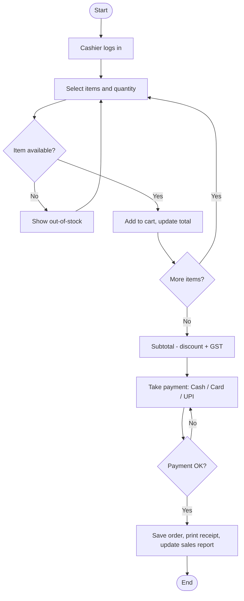
**Explanation:** shows the six stages of billing; the availability check and payment retry are the two decision loops.

## 2. Use case diagram (Exp 2 / 5)
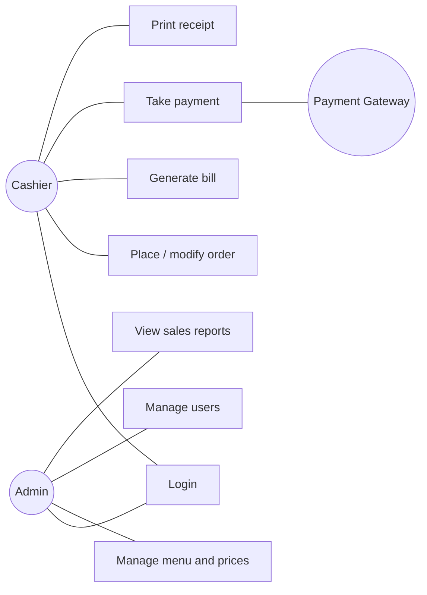
**Explanation:** Cashier handles the sale; Admin manages data and reports; the external Payment Gateway processes card/UPI.

## 3. Context diagram – DFD Level 0 (Exp 3)
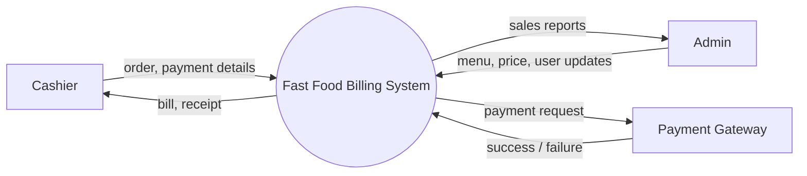
**Explanation:** one process with three external entities; no internal detail.

## 4. DFD Level 1 (Exp 3)
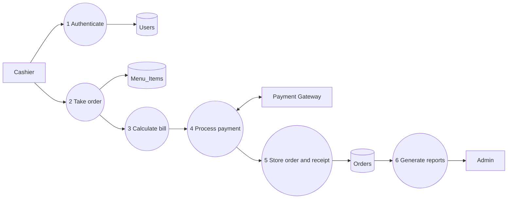
**Explanation:** breaks the system into six processes and three data stores.

## 5. ER diagram (Exp 4) – 7 entities, 8 tables
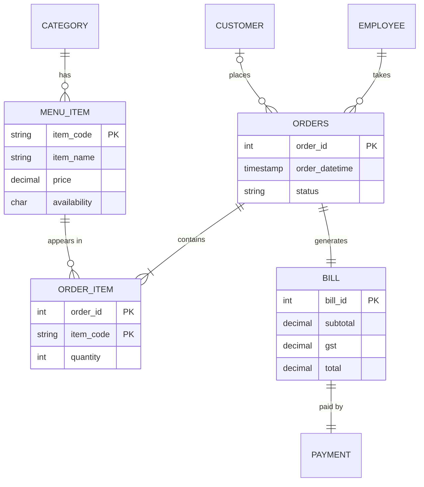
**Explanation:** M:N relation *contains* becomes the ORDER_ITEM table; 1:1 relations use FK + UNIQUE. SQL: `sql/02_schema_er.sql`.

## 6. Class diagram (Exp 6)
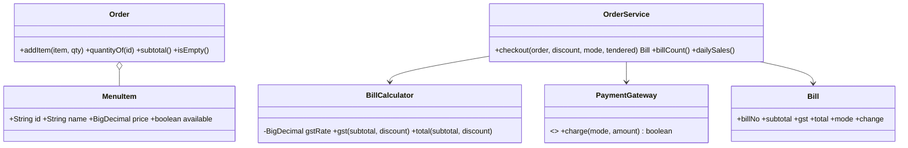

## 7. State-chart of an order (Exp 7)
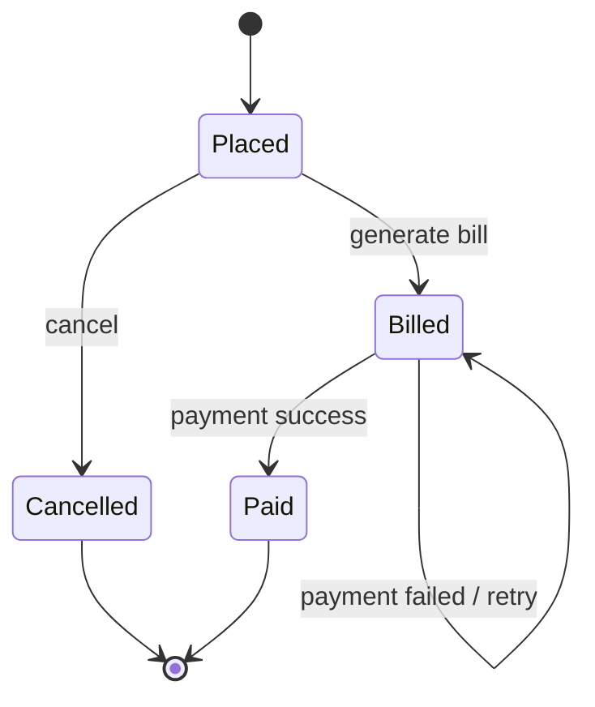

## 8. Sequence diagram – checkout (Exp 8)
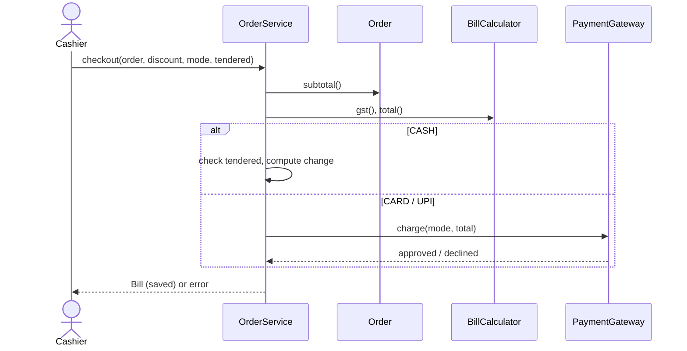

## 9. Component diagram (Exp 9)
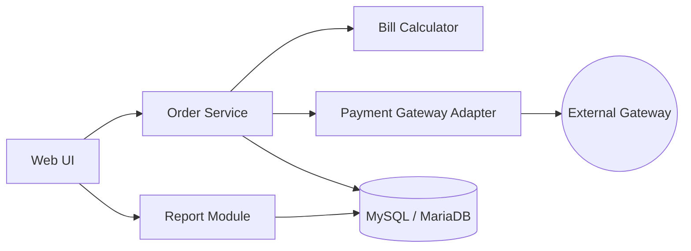

## 10. Deployment diagram (Exp 10)
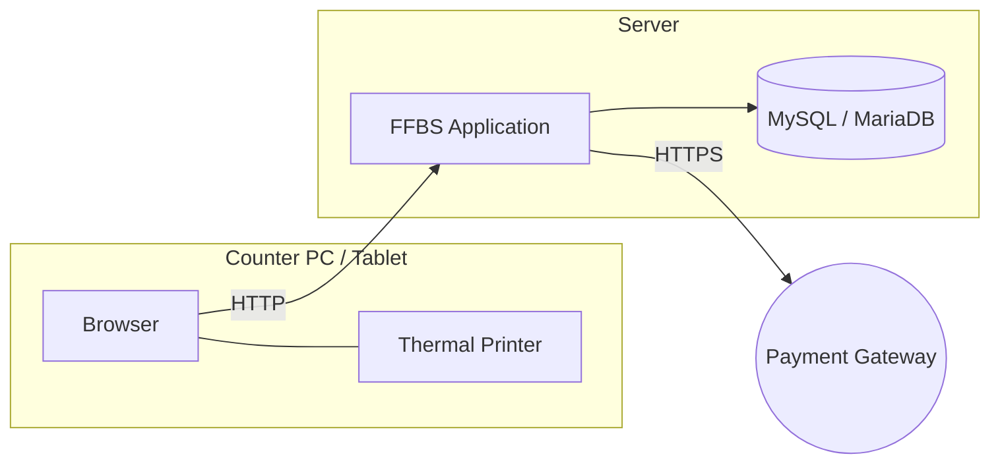

## 11. Gantt / PERT (Exp 13)
Critical path **A → B → D → E → F → H → I → J = 21 weeks** (see `python/pert_schedule.py`).
```mermaid
gantt
  dateFormat X
  axisFormat %s
  section Weeks
  A Requirements & SRS :0, 2
  B Design (UML, DB) :2, 5
  C Database creation :5, 7
  D Menu & order module :5, 9
  G User interface :5, 9
  E Billing & tax module :9, 12
  F Payment & receipt :12, 15
  H Integration :15, 17
  I Testing :17, 20
  J Deployment & training :20, 21
```
